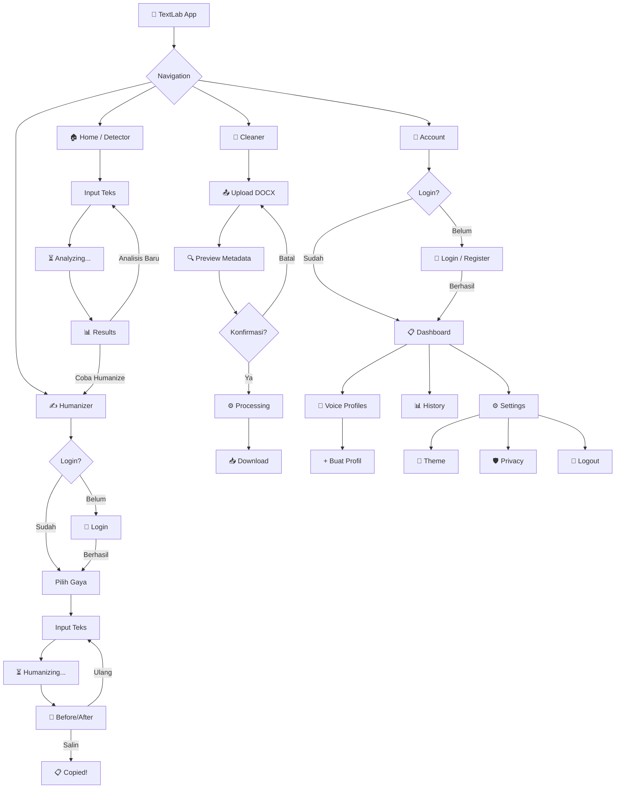
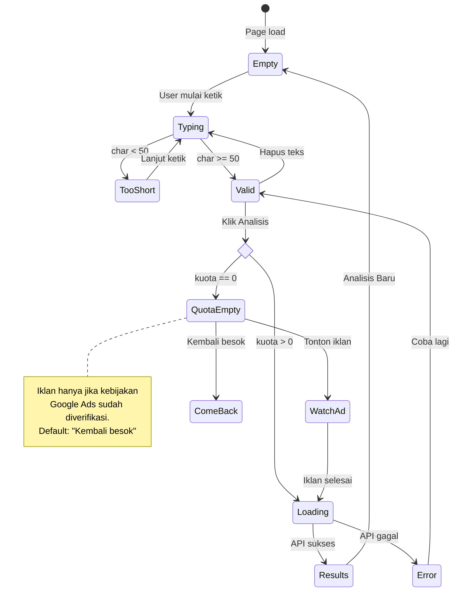
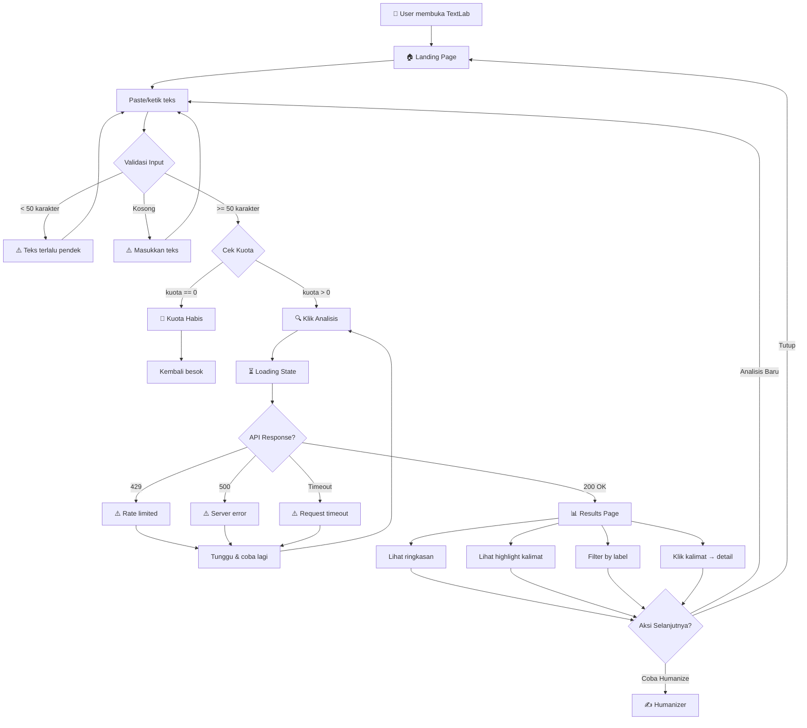
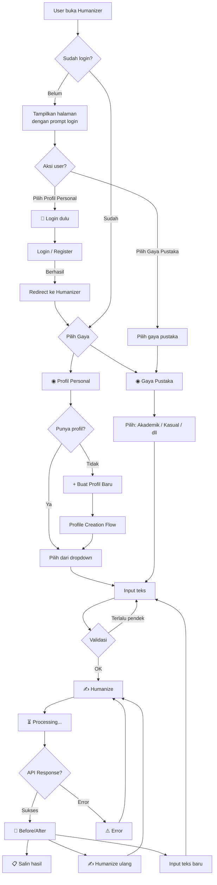
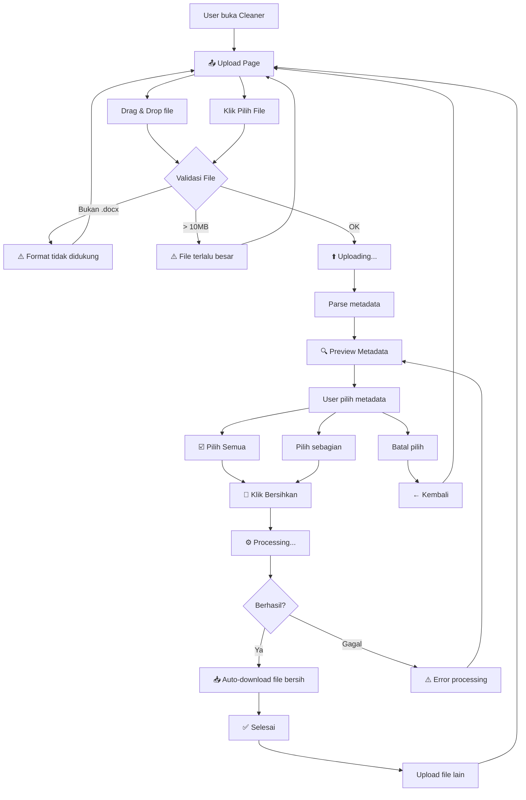
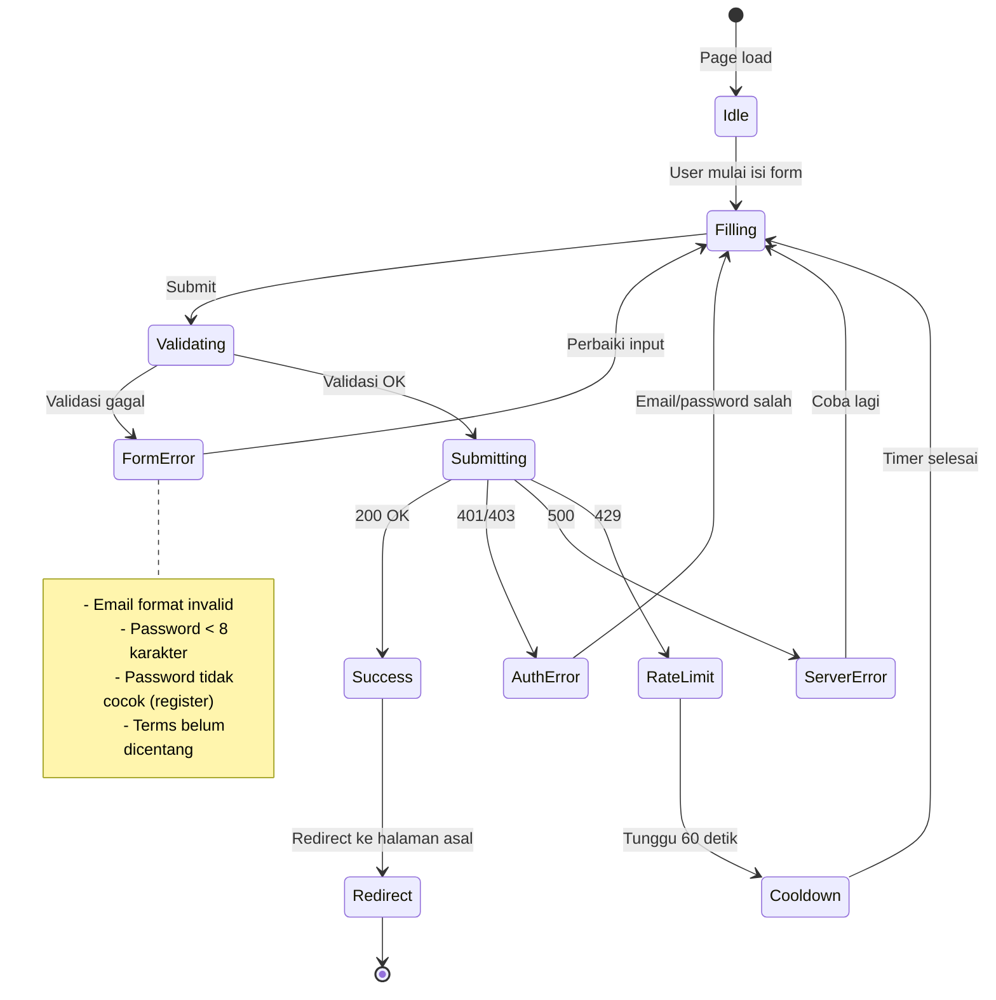
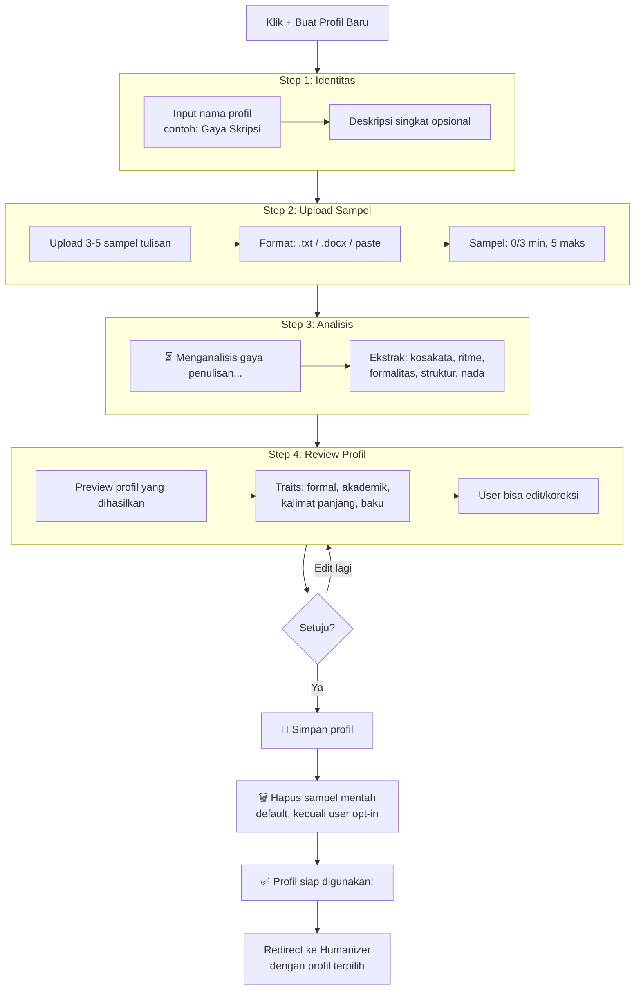
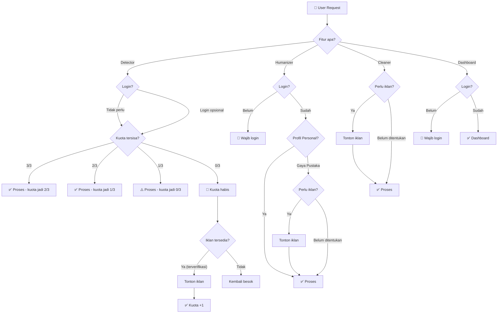

# 🖼️ TextLab — Wireframes & Flowcharts

**Dokumen terkait:** [Project Workflow](PROJECT-WORKFLOW.md), [Development Workflow](DEVELOPMENT-WORKFLOW.md), dan [Product & System Design](PRODUCT-AND-SYSTEM-DESIGN.md).  
**Tanggal:** 2026-11-09  
**Status:** rancangan wireframe dan alur interaksi; belum menjadi spesifikasi implementasi final.

---

> **Catatan status dan batasan**
> - Seluruh wireframe, flowchart, state diagram, dan breakpoint di dokumen ini adalah rancangan konseptual, bukan implementasi atau hasil pengujian.
> - Angka seperti batas minimum 50 karakter, kuota 3 penggunaan per hari, batas upload 10 MB, cooldown 60 detik, serta jumlah sampel adalah nilai rancangan/placeholder yang harus dikonfirmasi terhadap spesifikasi dan keputusan proyek sebelum implementasi.
> - Alur iklan hanya bersifat opsional dan tidak boleh diaktifkan sebelum kebijakan, kelayakan teknis, dan pengalaman pengguna diverifikasi. Jika belum terverifikasi, gunakan jalur tanpa iklan.
> - Klaim privasi pada mockup harus disesuaikan dengan perilaku sistem yang benar-benar diterapkan dan diuji. Jangan menjanjikan penghapusan seluruh jejak digital atau penyimpanan nol tanpa bukti teknis.
> - Data nama, email, dan metadata pada contoh layar bersifat placeholder, bukan data pengguna nyata.
> - Prioritas proyek saat ini tetap **uji prosedur sintetis dataset**. Dokumen desain ini tidak mengubah urutan prioritas riset.

## 1. Master Navigation Flow



---

## 2. Desktop — Global Layout

```
┌══════════════════════════════════════════════════════════════════════════┐
│ NAVBAR (sticky, backdrop-blur)                                         │
│ ┌──────────────────────────────────────────────────────────────────────┐│
│ │ 🧪 TextLab     │ Detector │ Humanizer │ Cleaner │    [Login]  🌙   ││
│ └──────────────────────────────────────────────────────────────────────┘│
├══════════════════════════════════════════════════════════════════════════┤
│                                                                        │
│                        ┌──────────────────────┐                        │
│                        │                      │                        │
│                        │    PAGE CONTENT       │                        │
│                        │    max-w: 1280px      │                        │
│                        │    mx: auto           │                        │
│                        │    px: 24px           │                        │
│                        │                      │                        │
│                        └──────────────────────┘                        │
│                                                                        │
├══════════════════════════════════════════════════════════════════════════┤
│ FOOTER                                                                 │
│ ┌──────────────────────────────────────────────────────────────────────┐│
│ │  🧪 TextLab          Produk          Legal          Sosial          ││
│ │  © 2026              Detector        Privasi        Media sosial         ││
│ │                      Humanizer       Ketentuan      GitHub          ││
│ │                      Cleaner         Kontak                         ││
│ └──────────────────────────────────────────────────────────────────────┘│
└══════════════════════════════════════════════════════════════════════════┘
```

## 3. Mobile — Global Layout

```
┌════════════════════════════┐
│ TOP BAR (auto-hide scroll) │
│ ┌────────────────────────┐ │
│ │ 🧪 TextLab    [≡] [🌙]│ │
│ └────────────────────────┘ │
├════════════════════════════┤
│                            │
│     PAGE CONTENT           │
│     px: 16px               │
│     pb: 80px (tab space)   │
│                            │
├════════════════════════════┤
│ BOTTOM TAB BAR (fixed)     │
│ ┌────────────────────────┐ │
│ │  🔍      ✍️     📄   👤│ │
│ │Detect  Human  Clean Akun│ │
│ └────────────────────────┘ │
└════════════════════════════┘
```

### Hamburger Drawer (Mobile)

```
┌════════════════════════════┐
│ 🧪 TextLab         [✕]    │
├────────────────────────────┤
│                            │
│  👤  Nama Pengguna        │
│      nama@example.com     │
│                            │
│  ─────────────────────     │
│                            │
│  🏠  Home                  │
│  🔍  Detector              │
│  ✍️  Humanizer             │
│  📄  Cleaner               │
│                            │
│  ─────────────────────     │
│                            │
│  📋  Dashboard             │
│  🎨  Voice Profiles        │
│  📊  Riwayat               │
│  ⚙️  Settings              │
│                            │
│  ─────────────────────     │
│                            │
│  🛡️  Kebijakan Privasi     │
│  📜  Ketentuan Layanan     │
│  ℹ️  Tentang TextLab       │
│                            │
│  ─────────────────────     │
│                            │
│  🚪  Logout                │
│                            │
└════════════════════════════┘
```

---

## 4. Screen 1 — Landing / Detector Input

### Desktop

```
┌══════════════════════════════════════════════════════════════════════════┐
│  🧪 TextLab     │ Detector │ Humanizer │ Cleaner │        [Login]  🌙  │
├══════════════════════════════════════════════════════════════════════════┤
│                                                                        │
│                          🧪                                            │
│                       TextLab                                          │
│                 "Kenali Asal Tulisanmu"                                 │
│            Analisis teks Bahasa Indonesia untuk                         │
│           mendeteksi konten yang dihasilkan AI.                         │
│                                                                        │
│     ┌──────────────────────────────────────────────────────────┐        │
│     │                                                          │        │
│     │  Tempelkan atau ketik teks Bahasa Indonesia di sini...   │        │
│     │                                                          │        │
│     │                                                          │        │
│     │                                                          │        │
│     │                                                          │        │
│     │                                                          │        │
│     │                                                          │        │
│     ├──────────────────────────────────────────────────────────┤        │
│     │  0 karakter (min. 50)                    ●●● 3/3 gratis  │        │
│     └──────────────────────────────────────────────────────────┘        │
│                                                                        │
│                    ┌─────────────────────────┐                         │
│                    │   🔍  Analisis Teks      │                         │
│                    └─────────────────────────┘                         │
│                                                                        │
│     ─────────────────  Fitur Lainnya  ──────────────────               │
│                                                                        │
│     ┌──────────────────┐  ┌──────────────────┐  ┌──────────────────┐   │
│     │  ✍️               │  │  📄               │  │  🛡️               │   │
│     │                  │  │                  │  │                  │   │
│     │  AI Humanizer    │  │  Metadata        │  │  Privasi         │   │
│     │                  │  │  Cleaner         │  │  Terjamin        │   │
│     │  Sesuaikan gaya  │  │                  │  │                  │   │
│     │  tulisanmu agar  │  │  Bersihkan       │  │  Teksmu diproses │   │
│     │  lebih personal  │  │  metadata DOCX   │  │  sementara &     │   │
│     │  dan autentik.   │  │  dengan mudah.   │  │  tidak disimpan. │   │
│     │                  │  │                  │  │                  │   │
│     │  [Coba →]        │  │  [Coba →]        │  │  [Pelajari →]    │   │
│     └──────────────────┘  └──────────────────┘  └──────────────────┘   │
│                                                                        │
├══════════════════════════════════════════════════════════════════════════┤
│  🧪 TextLab          Produk          Legal             Sosial          │
│  © 2026              Detector        Privasi           GitHub          │
└══════════════════════════════════════════════════════════════════════════┘
```

### Mobile

```
┌══════════════════════════════┐
│  🧪 TextLab         [≡] [🌙]│
├══════════════════════════════┤
│                              │
│           🧪                 │
│        TextLab               │
│   "Kenali Asal Tulisanmu"   │
│                              │
│  Analisis teks Bahasa        │
│  Indonesia untuk mendeteksi  │
│  konten AI.                  │
│                              │
│  ┌────────────────────────┐  │
│  │                        │  │
│  │  Tempelkan teks        │  │
│  │  di sini...            │  │
│  │                        │  │
│  │                        │  │
│  │                        │  │
│  ├────────────────────────┤  │
│  │  0 char    ●●● 3/3    │  │
│  └────────────────────────┘  │
│                              │
│  ┌────────────────────────┐  │
│  │   🔍  Analisis Teks    │  │
│  └────────────────────────┘  │
│                              │
│  ── Fitur Lainnya ────────   │
│                              │
│  ┌────────────────────────┐  │
│  │ ✍️ AI Humanizer        │  │
│  │ Sesuaikan gaya         │  │
│  │ tulisanmu.    [Coba →] │  │
│  └────────────────────────┘  │
│                              │
│  ┌────────────────────────┐  │
│  │ 📄 Metadata Cleaner    │  │
│  │ Bersihkan metadata     │  │
│  │ DOCX.        [Coba →]  │  │
│  └────────────────────────┘  │
│                              │
│  ┌────────────────────────┐  │
│  │ 🛡️ Privasi Terjamin    │  │
│  │ Teksmu tidak           │  │
│  │ disimpan.  [Info →]    │  │
│  └────────────────────────┘  │
│                              │
├══════════════════════════════┤
│  🔍      ✍️      📄     👤  │
│ Detect  Human  Clean  Akun   │
└══════════════════════════════┘
```

### Detector Input — State Flow



---

## 5. Screen 2 — Detector Results

### Desktop (Two-Column)

```
┌══════════════════════════════════════════════════════════════════════════┐
│  🧪 TextLab     │ Detector │ Humanizer │ Cleaner │        [👤 Pengguna] 🌙│
├══════════════════════════════════════════════════════════════════════════┤
│                                                                        │
│  ← Kembali                    Hasil Analisis                           │
│                                                                        │
│  ┌─────────────────────────┐  ┌────────────────────────────────────┐   │
│  │  📊 RINGKASAN           │  │  📝 TEKS DENGAN HIGHLIGHT          │   │
│  │                         │  │                                    │   │
│  │  Status Dokumen:        │  │  ┌────────────────────────────┐    │   │
│  │  ┌───────────────────┐  │  │  │ 🟢 "Pendidikan di         │    │   │
│  │  │      MIXED        │  │  │  │    Indonesia mengalami     │    │   │
│  │  └───────────────────┘  │  │  │    perkembangan pesat."    │    │   │
│  │                         │  │  │    Skor: 0.15 (HUMAN)      │    │   │
│  │  Distribusi:            │  │  └────────────────────────────┘    │   │
│  │  ████████████░░░░░░░░   │  │                                    │   │
│  │  HUMAN ████ 60%         │  │  ┌────────────────────────────┐    │   │
│  │  AI    ████ 30%         │  │  │ 🔴 "Dengan demikian,       │    │   │
│  │  UNCERTAIN █ 10%        │  │  │    dapat disimpulkan bahwa │    │   │
│  │                         │  │  │    transformasi digital    │    │   │
│  │  Detail:                │  │  │    telah memberikan..."    │    │   │
│  │  ● HUMAN: 6 kalimat    │  │  │    Skor: 0.87 (AI)        │    │   │
│  │  ● AI: 3 kalimat       │  │  └────────────────────────────┘    │   │
│  │  ● UNCERTAIN: 1        │  │                                    │   │
│  │                         │  │  ┌────────────────────────────┐    │   │
│  │  ─────────────────      │  │  │ 🟢 "Saya pribadi melihat  │    │   │
│  │                         │  │  │    hal ini dari sudut      │    │   │
│  │  Model: v0.1-lite      │  │  │    pandang berbeda."       │    │   │
│  │  Preprocessing: v1     │  │  │    Skor: 0.08 (HUMAN)      │    │   │
│  │                         │  │  └────────────────────────────┘    │   │
│  │  ─────────────────      │  │                                    │   │
│  │                         │  │  ┌────────────────────────────┐    │   │
│  │  ⚠️ Disclaimer          │  │  │ ⚪ "Hal tersebut perlu     │    │   │
│  │  Hasil ini adalah       │  │  │    dikaji lebih lanjut."   │    │   │
│  │  estimasi model, bukan  │  │  │    Skor: 0.48 (UNCERTAIN) │    │   │
│  │  bukti pasti asal-usul  │  │  └────────────────────────────┘    │   │
│  │  atau kepengarangan     │  │                                    │   │
│  │  teks.                  │  │  ┌────────────────────────────┐    │   │
│  │                         │  │  │ 🔴 "Implementasi kebijakan│    │   │
│  │  ─────────────────      │  │  │    ini memerlukan sinergi │    │   │
│  │                         │  │  │    antar pemangku..."     │    │   │
│  │  ┌───────────────────┐  │  │  │    Skor: 0.91 (AI)        │    │   │
│  │  │  🔍 Analisis Baru  │  │  │  └────────────────────────────┘    │   │
│  │  └───────────────────┘  │  │                                    │   │
│  │                         │  │  ──────────────────────────────    │   │
│  │  ┌───────────────────┐  │  │                                    │   │
│  │  │  ✍️ Coba Humanize  │  │  │  FILTER:                          │   │
│  │  └───────────────────┘  │  │  [🟢 HUMAN] [🔴 AI] [⚪ UNCERTAIN]│   │
│  │                         │  │                                    │   │
│  └─────────────────────────┘  └────────────────────────────────────┘   │
│                                                                        │
├══════════════════════════════════════════════════════════════════════════┤
│  FOOTER                                                                │
└══════════════════════════════════════════════════════════════════════════┘
```

### Mobile (Tabbed View)

```
┌══════════════════════════════┐
│  ← Hasil           🧪   🌙  │
├══════════════════════════════┤
│                              │
│  Status Dokumen:             │
│  ┌────────────────────────┐  │
│  │        MIXED           │  │
│  └────────────────────────┘  │
│                              │
│  ████████████░░░░░░░░        │
│  🟢 60%  🔴 30%  ⚪ 10%     │
│                              │
│  ┌────────────┬───────────┐  │
│  │  📊 Ringkas │ 📝 Kalimat│  │
│  ├────────────┴───────────┤  │
│  │                        │  │
│  │  ┌──────────────────┐  │  │
│  │  │ 🟢 "Pendidikan   │  │  │
│  │  │ di Indonesia     │  │  │
│  │  │ mengalami..."    │  │  │
│  │  │ Skor: 0.15       │  │  │
│  │  └──────────────────┘  │  │
│  │                        │  │
│  │  ┌──────────────────┐  │  │
│  │  │ 🔴 "Dengan       │  │  │
│  │  │ demikian, dapat  │  │  │
│  │  │ disimpulkan..."  │  │  │
│  │  │ Skor: 0.87       │  │  │
│  │  └──────────────────┘  │  │
│  │                        │  │
│  │  ┌──────────────────┐  │  │
│  │  │ ⚪ "Hal tersebut │  │  │
│  │  │ perlu dikaji..." │  │  │
│  │  │ Skor: 0.48       │  │  │
│  │  └──────────────────┘  │  │
│  │                        │  │
│  └────────────────────────┘  │
│                              │
│  FILTER:                     │
│  [🟢ALL] [🔴AI] [⚪UNSURE]  │
│                              │
│  ⚠️ Estimasi model, bukan   │
│  bukti pasti.                │
│                              │
│  ┌────────────────────────┐  │
│  │   🔍 Analisis Baru     │  │
│  └────────────────────────┘  │
│  ┌────────────────────────┐  │
│  │   ✍️ Coba Humanize     │  │
│  └────────────────────────┘  │
│                              │
├══════════════════════════════┤
│  🔍      ✍️      📄     👤  │
│ Detect  Human  Clean  Akun   │
└══════════════════════════════┘
```

### Detector — Full User Journey



---

## 6. Screen 3 — Humanizer Input

### Desktop

```
┌══════════════════════════════════════════════════════════════════════════┐
│  🧪 TextLab     │ Detector │ Humanizer │ Cleaner │      [👤 Pengguna]  🌙 │
├══════════════════════════════════════════════════════════════════════════┤
│                                                                        │
│                       ✍️ AI Humanizer                                   │
│                 "Sesuaikan gaya penulisanmu"                            │
│                                                                        │
│     ┌──────────────────────────────────────────────────────────┐        │
│     │  📌 PILIH GAYA PENULISAN                                 │        │
│     │                                                          │        │
│     │  ┌─────────────────────────────────────────────────────┐ │        │
│     │  │ ◉ Profil Personal                                   │ │        │
│     │  │   🎨 "Gaya Skripsi"  ▾  (dropdown profil)           │ │        │
│     │  │   [+ Buat Profil Baru]  [Kelola Profil →]           │ │        │
│     │  └─────────────────────────────────────────────────────┘ │        │
│     │                                                          │        │
│     │  ── atau pilih gaya pustaka ──                           │        │
│     │                                                          │        │
│     │  ┌────────────┐ ┌────────────┐ ┌────────────┐           │        │
│     │  │ ○ 🎓       │ │ ○ 💬       │ │ ○ 📰       │           │        │
│     │  │ Akademik   │ │ Kasual     │ │ Jurnalistik│           │        │
│     │  └────────────┘ └────────────┘ └────────────┘           │        │
│     │  ┌────────────┐ ┌────────────┐                           │        │
│     │  │ ○ 💼       │ │ ○ 📖       │                           │        │
│     │  │ Bisnis     │ │ Naratif    │                           │        │
│     │  └────────────┘ └────────────┘                           │        │
│     └──────────────────────────────────────────────────────────┘        │
│                                                                        │
│     ┌──────────────────────────────────────────────────────────┐        │
│     │                                                          │        │
│     │  Tempelkan teks yang ingin di-humanize...                │        │
│     │                                                          │        │
│     │                                                          │        │
│     │                                                          │        │
│     │                                                          │        │
│     ├──────────────────────────────────────────────────────────┤        │
│     │  0 karakter                                              │        │
│     └──────────────────────────────────────────────────────────┘        │
│                                                                        │
│                    ┌─────────────────────────┐                         │
│                    │   ✍️  Humanize Teks      │                         │
│                    └─────────────────────────┘                         │
│                                                                        │
├══════════════════════════════════════════════════════════════════════════┤
│  FOOTER                                                                │
└══════════════════════════════════════════════════════════════════════════┘
```

### Mobile

```
┌══════════════════════════════┐
│  🧪 TextLab         [≡] [🌙]│
├══════════════════════════════┤
│                              │
│  ✍️ AI Humanizer             │
│  "Sesuaikan gaya             │
│   penulisanmu"               │
│                              │
│  ┌────────────────────────┐  │
│  │ 📌 PILIH GAYA          │  │
│  │                        │  │
│  │ ◉ Profil Personal      │  │
│  │   "Gaya Skripsi"  ▾    │  │
│  │   [+ Buat] [Kelola →]  │  │
│  │                        │  │
│  │ ── atau pustaka ──     │  │
│  │                        │  │
│  │ ┌──────┐ ┌──────┐      │  │
│  │ │🎓    │ │💬    │      │  │
│  │ │Akade.│ │Kasual│      │  │
│  │ └──────┘ └──────┘      │  │
│  │ ┌──────┐ ┌──────┐      │  │
│  │ │📰    │ │💼    │      │  │
│  │ │Jurna.│ │Bisnis│      │  │
│  │ └──────┘ └──────┘      │  │
│  └────────────────────────┘  │
│                              │
│  ┌────────────────────────┐  │
│  │                        │  │
│  │  Tempelkan teks...     │  │
│  │                        │  │
│  │                        │  │
│  ├────────────────────────┤  │
│  │  0 karakter            │  │
│  └────────────────────────┘  │
│                              │
│  ┌────────────────────────┐  │
│  │  ✍️  Humanize Teks     │  │
│  └────────────────────────┘  │
│                              │
├══════════════════════════════┤
│  🔍      ✍️      📄     👤  │
│ Detect  Human  Clean  Akun   │
└══════════════════════════════┘
```

### Humanizer — Full User Journey



---

## 7. Screen 4 — Humanizer Results

### Desktop (Side-by-Side Diff)

```
┌══════════════════════════════════════════════════════════════════════════┐
│  🧪 TextLab     │ Detector │ Humanizer │ Cleaner │      [👤 Pengguna]  🌙 │
├══════════════════════════════════════════════════════════════════════════┤
│                                                                        │
│  ← Kembali                 Hasil Humanize                              │
│                                                                        │
│  Gaya: 🎓 Akademik  ·  Makna ✅  ·  Kutipan ✅  ·  Struktur ✅         │
│                                                                        │
│  ┌─────────────────────────────┐  ┌─────────────────────────────┐      │
│  │  📄 ORIGINAL                │  │  ✍️ HUMANIZED                │      │
│  │                             │  │                             │      │
│  │  Dengan demikian, dapat     │  │  Oleh karena itu, bisa      │      │
│  │  disimpulkan bahwa          │  │  kita simpulkan bahwa       │      │
│  │  ~~transformasi digital~~   │  │  **perubahan teknologi**    │      │
│  │  telah memberikan           │  │  sudah memberikan           │      │
│  │  ~~dampak signifikan~~      │  │  **pengaruh yang cukup      │      │
│  │  terhadap berbagai aspek    │  │  besar** terhadap banyak    │      │
│  │  kehidupan masyarakat       │  │  sisi kehidupan masyarakat  │      │
│  │  ~~Indonesia secara         │  │  **di Indonesia, terutama   │      │
│  │  komprehensif~~.            │  │  dalam hal menyeluruh**.    │      │
│  │                             │  │                             │      │
│  │  ~~Perlu dicatat bahwa~~    │  │  **Penting untuk diingat    │      │
│  │  implementasi kebijakan     │  │  bahwa** penerapan aturan   │      │
│  │  ini memerlukan sinergi     │  │  ini butuh kerja sama       │      │
│  │  antar pemangku             │  │  antar pihak yang           │      │
│  │  kepentingan.               │  │  berkepentingan.            │      │
│  │                             │  │                             │      │
│  │  ~~strikethrough~~ =        │  │  **bold** = bagian baru     │      │
│  │  bagian yang berubah        │  │                             │      │
│  └─────────────────────────────┘  └─────────────────────────────┘      │
│                                                                        │
│  ┌──────────────────┐  ┌──────────────────┐  ┌──────────────────┐      │
│  │  📋 Salin Hasil   │  │  ✍️ Humanize Ulang│  │  🔍 Cek Detector │      │
│  └──────────────────┘  └──────────────────┘  └──────────────────┘      │
│                                                                        │
├══════════════════════════════════════════════════════════════════════════┤
│  FOOTER                                                                │
└══════════════════════════════════════════════════════════════════════════┘
```

### Mobile (Tab Toggle)

```
┌══════════════════════════════┐
│  ← Hasil           🧪   🌙  │
├══════════════════════════════┤
│                              │
│  Gaya: 🎓 Akademik          │
│  Makna ✅ Kutipan ✅          │
│                              │
│  ┌───────────┬────────────┐  │
│  │ 📄 Original│✍️ Humanized│  │
│  ├───────────┴────────────┤  │
│  │                        │  │
│  │  Oleh karena itu,      │  │
│  │  bisa kita simpulkan   │  │
│  │  bahwa **perubahan     │  │
│  │  teknologi** sudah     │  │
│  │  memberikan            │  │
│  │  **pengaruh yang       │  │
│  │  cukup besar**         │  │
│  │  terhadap banyak sisi  │  │
│  │  kehidupan masyarakat  │  │
│  │  **di Indonesia**.     │  │
│  │                        │  │
│  │  **Penting untuk       │  │
│  │  diingat bahwa**       │  │
│  │  penerapan aturan      │  │
│  │  ini butuh kerja       │  │
│  │  sama antar pihak      │  │
│  │  yang berkepentingan.  │  │
│  │                        │  │
│  │  **bold** = baru       │  │
│  └────────────────────────┘  │
│                              │
│  ┌────────────────────────┐  │
│  │   📋 Salin Hasil       │  │
│  └────────────────────────┘  │
│  ┌────────────────────────┐  │
│  │   ✍️ Humanize Ulang    │  │
│  └────────────────────────┘  │
│  ┌────────────────────────┐  │
│  │   🔍 Cek Detector      │  │
│  └────────────────────────┘  │
│                              │
├══════════════════════════════┤
│  🔍      ✍️      📄     👤  │
│ Detect  Human  Clean  Akun   │
└══════════════════════════════┘
```

---

## 8. Screen 5 — DOCX Metadata Cleaner

### Desktop — Step 1: Upload

```
┌══════════════════════════════════════════════════════════════════════════┐
│  🧪 TextLab     │ Detector │ Humanizer │ Cleaner │        [Login]  🌙  │
├══════════════════════════════════════════════════════════════════════════┤
│                                                                        │
│                     📄 Metadata Cleaner                                 │
│              "Bersihkan jejak metadata dokumenmu"                       │
│                                                                        │
│     ┌──────────────────────────────────────────────────────────┐        │
│     │                                                          │        │
│     │                         📁                               │        │
│     │                                                          │        │
│     │             Seret file DOCX ke sini                      │        │
│     │                  atau                                    │        │
│     │            ┌──────────────────┐                          │        │
│     │            │   Pilih File...   │                          │        │
│     │            └──────────────────┘                          │        │
│     │                                                          │        │
│     │         Maks. 10MB  ·  Format: .docx saja                │        │
│     │                                                          │        │
│     └──────────────────────────────────────────────────────────┘        │
│                                                                        │
│     ⚠️ Metadata cleaner tidak menjamin penghapusan seluruh             │
│        jejak digital. Lihat ketentuan penggunaan.                      │
│                                                                        │
├══════════════════════════════════════════════════════════════════════════┤
│  FOOTER                                                                │
└══════════════════════════════════════════════════════════════════════════┘
```

### Desktop — Step 2: Preview & Clean

```
┌══════════════════════════════════════════════════════════════════════════┐
│  🧪 TextLab     │ Detector │ Humanizer │ Cleaner │        [Login]  🌙  │
├══════════════════════════════════════════════════════════════════════════┤
│                                                                        │
│  ← Kembali               Preview Metadata                              │
│                                                                        │
│  ┌──────────────────────────────────────────────────────────────┐       │
│  │  📄 laporan-skripsi-final.docx                    3.2 MB    │       │
│  └──────────────────────────────────────────────────────────────┘       │
│                                                                        │
│  ┌──────────────────────────────────────────────────────────────┐       │
│  │  METADATA DITEMUKAN                                          │       │
│  │                                                              │       │
│  │  ┌─────────────────────────────────────────────────────────┐ │       │
│  │  │  ☑️  Author              │  Nama Penulis               │ │       │
│  │  ├─────────────────────────────────────────────────────────┤ │       │
│  │  │  ☑️  Last Modified By    │  Dosen Pembimbing           │ │       │
│  │  ├─────────────────────────────────────────────────────────┤ │       │
│  │  │  ☑️  Created             │  2026-03-15T10:30:00        │ │       │
│  │  ├─────────────────────────────────────────────────────────┤ │       │
│  │  │  ☑️  Last Modified       │  2026-10-20T14:22:00        │ │       │
│  │  ├─────────────────────────────────────────────────────────┤ │       │
│  │  │  ☑️  Company             │  Universitas XYZ            │ │       │
│  │  ├─────────────────────────────────────────────────────────┤ │       │
│  │  │  ☑️  Manager             │  -                          │ │       │
│  │  ├─────────────────────────────────────────────────────────┤ │       │
│  │  │  ☑️  Revision Number     │  47                         │ │       │
│  │  ├─────────────────────────────────────────────────────────┤ │       │
│  │  │  ☑️  Comments            │  "Draft v3 - revisi bab 4"  │ │       │
│  │  └─────────────────────────────────────────────────────────┘ │       │
│  │                                                              │       │
│  │  ☑️ Pilih Semua    □ Batal Semua                              │       │
│  │                                                              │       │
│  │  ┌───────────────────────────────┐                           │       │
│  │  │  🧹 Bersihkan & Download      │                           │       │
│  │  └───────────────────────────────┘                           │       │
│  └──────────────────────────────────────────────────────────────┘       │
│                                                                        │
├══════════════════════════════════════════════════════════════════════════┤
│  FOOTER                                                                │
└══════════════════════════════════════════════════════════════════════════┘
```

### Mobile — Upload + Preview

```
┌══════════════════════════════┐     ┌══════════════════════════════┐
│  🧪 TextLab         [≡] [🌙]│     │  ← Preview          🧪  🌙  │
├══════════════════════════════┤     ├══════════════════════════════┤
│                              │     │                              │
│  📄 Metadata Cleaner         │     │  📄 laporan-final.docx       │
│  "Bersihkan metadata"        │     │     3.2 MB                   │
│                              │     │                              │
│  ┌────────────────────────┐  │     │  METADATA:                   │
│  │                        │  │     │  ┌────────────────────────┐  │
│  │       📁               │  │     │  │ ☑️ Author              │  │
│  │                        │  │     │  │   Nama Penulis         │  │
│  │  Seret file DOCX       │  │     │  ├────────────────────────┤  │
│  │  atau [Pilih File]     │  │     │  │ ☑️ Last Modified By    │  │
│  │                        │  │     │  │   Dosen Pembimbing     │  │
│  │  Maks. 10MB            │  │     │  ├────────────────────────┤  │
│  │                        │  │     │  │ ☑️ Created             │  │
│  └────────────────────────┘  │     │  │   2026-03-15           │  │
│                              │     │  ├────────────────────────┤  │
│  ⚠️ Tidak menjamin          │     │  │ ☑️ Company             │  │
│  penghapusan seluruh         │     │  │   Universitas XYZ      │  │
│  jejak digital.              │     │  ├────────────────────────┤  │
│                              │     │  │ ☑️ Comments            │  │
│                              │     │  │   "Draft v3"           │  │
│                              │     │  └────────────────────────┘  │
│                              │     │                              │
│                              │     │  ☑️ Pilih Semua             │
│                              │     │                              │
│                              │     │  ┌────────────────────────┐  │
│                              │     │  │ 🧹 Bersihkan & Download│  │
│                              │     │  └────────────────────────┘  │
│                              │     │                              │
├══════════════════════════════┤     ├══════════════════════════════┤
│  🔍      ✍️      📄     👤  │     │  🔍      ✍️      📄     👤  │
│ Detect  Human  Clean  Akun   │     │ Detect  Human  Clean  Akun   │
└══════════════════════════════┘     └══════════════════════════════┘
       (Step 1: Upload)                    (Step 2: Preview)
```

### Cleaner — Full Flow



---

## 9. Screen 6 — Auth (Login & Register)

### Desktop — Modal Overlay

```
┌══════════════════════════════════════════════════════════════════════════┐
│  🧪 TextLab     │ Detector │ Humanizer │ Cleaner │        [Login]  🌙  │
├══════════════════════════════════════════════════════════════════════════┤
│  ░░░░░░░░░░░░░░░░░░░░░░░░░░░░░░░░░░░░░░░░░░░░░░░░░░░░░░░░░░░░░░░░░░  │
│  ░░░░░░░░░░░░░░░░░░░░░░░░░░░░░░░░░░░░░░░░░░░░░░░░░░░░░░░░░░░░░░░░░░  │
│  ░░░░░░░░  ┌─────────────────────────────────────────┐  ░░░░░░░░░░░░  │
│  ░░░░░░░░  │                                   [✕]   │  ░░░░░░░░░░░░  │
│  ░░░░░░░░  │          🧪 Masuk ke TextLab             │  ░░░░░░░░░░░░  │
│  ░░░░░░░░  │                                         │  ░░░░░░░░░░░░  │
│  ░░░░░░░░  │  ┌───────────────────────────────────┐  │  ░░░░░░░░░░░░  │
│  ░░░░░░░░  │  │ 📧 Email                          │  │  ░░░░░░░░░░░░  │
│  ░░░░░░░░  │  └───────────────────────────────────┘  │  ░░░░░░░░░░░░  │
│  ░░░░░░░░  │                                         │  ░░░░░░░░░░░░  │
│  ░░░░░░░░  │  ┌───────────────────────────────────┐  │  ░░░░░░░░░░░░  │
│  ░░░░░░░░  │  │ 🔒 Password                  [👁] │  │  ░░░░░░░░░░░░  │
│  ░░░░░░░░  │  └───────────────────────────────────┘  │  ░░░░░░░░░░░░  │
│  ░░░░░░░░  │                                         │  ░░░░░░░░░░░░  │
│  ░░░░░░░░  │  [Lupa password?]                       │  ░░░░░░░░░░░░  │
│  ░░░░░░░░  │                                         │  ░░░░░░░░░░░░  │
│  ░░░░░░░░  │  ┌───────────────────────────────────┐  │  ░░░░░░░░░░░░  │
│  ░░░░░░░░  │  │           🔐 Masuk                │  │  ░░░░░░░░░░░░  │
│  ░░░░░░░░  │  └───────────────────────────────────┘  │  ░░░░░░░░░░░░  │
│  ░░░░░░░░  │                                         │  ░░░░░░░░░░░░  │
│  ░░░░░░░░  │  ──────── atau ────────                 │  ░░░░░░░░░░░░  │
│  ░░░░░░░░  │                                         │  ░░░░░░░░░░░░  │
│  ░░░░░░░░  │  ┌───────────────────────────────────┐  │  ░░░░░░░░░░░░  │
│  ░░░░░░░░  │  │  G  Lanjutkan dengan Google       │  │  ░░░░░░░░░░░░  │
│  ░░░░░░░░  │  └───────────────────────────────────┘  │  ░░░░░░░░░░░░  │
│  ░░░░░░░░  │                                         │  ░░░░░░░░░░░░  │
│  ░░░░░░░░  │  Belum punya akun? [Daftar]             │  ░░░░░░░░░░░░  │
│  ░░░░░░░░  │                                         │  ░░░░░░░░░░░░  │
│  ░░░░░░░░  └─────────────────────────────────────────┘  ░░░░░░░░░░░░  │
│  ░░░░░░░░░░░░░░░░░░░░░░░░░░░░░░░░░░░░░░░░░░░░░░░░░░░░░░░░░░░░░░░░░░  │
└══════════════════════════════════════════════════════════════════════════┘
```

### Mobile — Full Page

```
┌══════════════════════════════┐     ┌══════════════════════════════┐
│  ← Masuk           🧪       │     │  ← Daftar          🧪       │
├══════════════════════════════┤     ├══════════════════════════════┤
│                              │     │                              │
│         🧪                   │     │         🧪                   │
│      TextLab                 │     │      TextLab                 │
│                              │     │                              │
│  Masuk ke akunmu             │     │  Buat akun baru              │
│                              │     │                              │
│  ┌────────────────────────┐  │     │  ┌────────────────────────┐  │
│  │ 📧 Email               │  │     │  │ 👤 Nama Lengkap        │  │
│  └────────────────────────┘  │     │  └────────────────────────┘  │
│                              │     │                              │
│  ┌────────────────────────┐  │     │  ┌────────────────────────┐  │
│  │ 🔒 Password       [👁] │  │     │  │ 📧 Email               │  │
│  └────────────────────────┘  │     │  └────────────────────────┘  │
│                              │     │                              │
│  [Lupa password?]            │     │  ┌────────────────────────┐  │
│                              │     │  │ 🔒 Password       [👁] │  │
│  ┌────────────────────────┐  │     │  └────────────────────────┘  │
│  │      🔐 Masuk          │  │     │                              │
│  └────────────────────────┘  │     │  ┌────────────────────────┐  │
│                              │     │  │ 🔒 Konfirmasi     [👁] │  │
│  ──────── atau ────────      │     │  └────────────────────────┘  │
│                              │     │                              │
│  ┌────────────────────────┐  │     │  ☑️ Saya setuju dengan      │
│  │ G Lanjutkan dgn Google │  │     │  ketentuan layanan          │
│  └────────────────────────┘  │     │                              │
│                              │     │  ┌────────────────────────┐  │
│  Belum punya akun? [Daftar]  │     │  │     📝 Daftar          │  │
│                              │     │  └────────────────────────┘  │
│                              │     │                              │
│                              │     │  ──────── atau ────────      │
│                              │     │                              │
│                              │     │  ┌────────────────────────┐  │
│                              │     │  │ G Lanjutkan dgn Google │  │
│                              │     │  └────────────────────────┘  │
│                              │     │                              │
│                              │     │  Sudah punya akun? [Masuk]  │
│                              │     │                              │
├══════════════════════════════┤     ├══════════════════════════════┤
│  🔍      ✍️      📄     👤  │     │  🔍      ✍️      📄     👤  │
└══════════════════════════════┘     └══════════════════════════════┘
         (Login)                            (Register)
```

### Auth — State Machine



---

## 10. Screen 7 — Dashboard & Voice Profiles

### Desktop — Dashboard Overview

```
┌══════════════════════════════════════════════════════════════════════════┐
│  🧪 TextLab     │ Detector │ Humanizer │ Cleaner │      [👤 Pengguna]  🌙 │
├══════════════════════════════════════════════════════════════════════════┤
│                                                                        │
│  ┌────────────┐                                                        │
│  │ 👤         │  Nama Penulis                                           │
│  │            │  nama@example.com                                       │
│  │ [Avatar]   │  Bergabung: Nov 2026                                   │
│  └────────────┘                                                        │
│                                                                        │
│  ┌─────────────────┐  ┌─────────────────┐  ┌─────────────────┐        │
│  │  🎨 Voice        │  │  📊 Riwayat      │  │  ⚙️ Settings     │        │
│  │  Profiles        │  │  Penggunaan     │  │                 │        │
│  │                  │  │                 │  │  Tema, privasi, │        │
│  │  2 profil aktif  │  │  14 deteksi     │  │  akun           │        │
│  │                  │  │  8 humanize     │  │                 │        │
│  │  [Kelola →]      │  │  [Lihat →]      │  │  [Buka →]       │        │
│  └─────────────────┘  └─────────────────┘  └─────────────────┘        │
│                                                                        │
│  ── Voice Profiles ────────────────────────────────────────────        │
│                                                                        │
│  ┌──────────────────────────────────────────────────────────────┐       │
│  │  🎨  "Gaya Skripsi"                                         │       │
│  │                                                              │       │
│  │  Formal · Akademik · Bahasa baku                             │       │
│  │  5 sampel · Dibuat: 01 Okt 2026                              │       │
│  │                                                    [Edit] [🗑]│       │
│  ├──────────────────────────────────────────────────────────────┤       │
│  │  🎨  "Gaya Blog"                                             │       │
│  │                                                              │       │
│  │  Semi-formal · Conversational · Santai                       │       │
│  │  3 sampel · Dibuat: 15 Okt 2026                              │       │
│  │                                                    [Edit] [🗑]│       │
│  ├──────────────────────────────────────────────────────────────┤       │
│  │                                                              │       │
│  │            ┌──────────────────────────┐                      │       │
│  │            │  + Buat Profil Baru       │                      │       │
│  │            └──────────────────────────┘                      │       │
│  │                                                              │       │
│  └──────────────────────────────────────────────────────────────┘       │
│                                                                        │
│  ── Riwayat Terbaru ──────────────────────────────────────────         │
│                                                                        │
│  ┌──────────────────────────────────────────────────────────────┐       │
│  │  🔍 Deteksi  ·  09 Nov 2026 12:30  ·  MIXED  ·  347 char    │       │
│  │  ✍️ Humanize ·  08 Nov 2026 09:15  ·  Akademik ·  512 char  │       │
│  │  📄 Cleaner  ·  07 Nov 2026 16:45  ·  laporan.docx          │       │
│  │                                            [Lihat Semua →]   │       │
│  └──────────────────────────────────────────────────────────────┘       │
│                                                                        │
├══════════════════════════════════════════════════════════════════════════┤
│  FOOTER                                                                │
└══════════════════════════════════════════════════════════════════════════┘
```

### Mobile — Dashboard

```
┌══════════════════════════════┐
│  🧪 TextLab         [≡] [🌙]│
├══════════════════════════════┤
│                              │
│  ┌──────┐                    │
│  │ 👤   │  Nama Penulis       │
│  └──────┘  nama@example.com   │
│                              │
│  ┌──────┐ ┌──────┐ ┌──────┐ │
│  │🎨    │ │📊    │ │⚙️    │ │
│  │Profil│ │Histor│ │Sett. │ │
│  │  2   │ │  14  │ │      │ │
│  └──────┘ └──────┘ └──────┘ │
│                              │
│  ── Voice Profiles ──        │
│                              │
│  ┌────────────────────────┐  │
│  │ 🎨 "Gaya Skripsi"      │  │
│  │ Formal · Akademik       │  │
│  │ 5 sampel · 01 Okt 2026 │  │
│  │            [Edit] [🗑]  │  │
│  └────────────────────────┘  │
│                              │
│  ┌────────────────────────┐  │
│  │ 🎨 "Gaya Blog"         │  │
│  │ Semi-formal · Santai    │  │
│  │ 3 sampel · 15 Okt 2026 │  │
│  │            [Edit] [🗑]  │  │
│  └────────────────────────┘  │
│                              │
│  ┌────────────────────────┐  │
│  │  + Buat Profil Baru    │  │
│  └────────────────────────┘  │
│                              │
│  ── Riwayat Terbaru ──      │
│                              │
│  🔍 09 Nov · MIXED · 347ch  │
│  ✍️ 08 Nov · Akademik       │
│  📄 07 Nov · laporan.docx   │
│             [Lihat Semua →]  │
│                              │
├══════════════════════════════┤
│  🔍      ✍️      📄     👤  │
│ Detect  Human  Clean  Akun   │
└══════════════════════════════┘
```

### Voice Profile Creation — Step-by-Step



---

## 11. Kuota & Access Control — Flow



---

## 12. Responsive Breakpoint Behavior

```mermaid
flowchart LR
    subgraph MOBILE["📱 Mobile - under 640px"]
        M1["Bottom Tab Bar"]
        M2["Single column"]
        M3["Hamburger drawer"]
        M4["Tabbed views"]
        M5["Full-page auth"]
        M6["Stacked cards"]
        M7["Top bar auto-hide"]
    end

    subgraph TABLET["📱 Tablet - 640px to 1024px"]
        T1["Bottom Tab Bar hidden"]
        T2["Top navbar visible"]
        T3["2-column grid"]
        T4["Side-by-side diff"]
        T5["Modal auth"]
        T6["Cards in 2-col grid"]
        T7["Sticky navbar"]
    end

    subgraph DESKTOP["💻 Desktop - over 1024px"]
        D1["Full top navbar"]
        D2["12-column grid"]
        D3["Two-panel results"]
        D4["Side-by-side diff"]
        D5["Modal auth overlay"]
        D6["Cards in 3-col grid"]
        D7["Sticky navbar + blur"]
    end

    MOBILE --> TABLET --> DESKTOP
```



### Component Behavior per Breakpoint

| Komponen | Mobile (< 640px) | Tablet (640–1024px) | Desktop (> 1024px) |
|---|---|---|---|
| **Navigation** | Bottom Tab Bar + Hamburger | Top Navbar | Top Navbar |
| **Detector Results** | Tabbed (Ringkasan / Kalimat) | Two-column | Two-column (sticky sidebar) |
| **Humanizer Results** | Tab Toggle (Original / Humanized) | Side-by-side | Side-by-side |
| **Feature Cards** | Stacked (1 column) | 2-column grid | 3-column grid |
| **Auth Form** | Full-page | Modal overlay | Modal overlay |
| **Dashboard Cards** | 3 mini cards in row | 3 cards in row | 3 cards in row |
| **Voice Profile List** | Full-width cards | Full-width cards | Full-width cards (max 800px) |
| **Textarea** | Full width, shorter | Full width | Max 720px, centered |
| **Footer** | Stacked, simplified | 4-column | 4-column |
| **Font sizes** | -1px to -2px smaller | Base size | Base size |

---

*Wireframes dan flowcharts ini merupakan rancangan visual untuk panduan diskusi dan implementasi. Dokumen ini belum membuktikan bahwa layar atau interaksi sudah dibuat. Detail arsitektur dan urutan proyek mengikuti [Product & System Design](PRODUCT-AND-SYSTEM-DESIGN.md), [Development Workflow](DEVELOPMENT-WORKFLOW.md), dan [Project Workflow](PROJECT-WORKFLOW.md).*